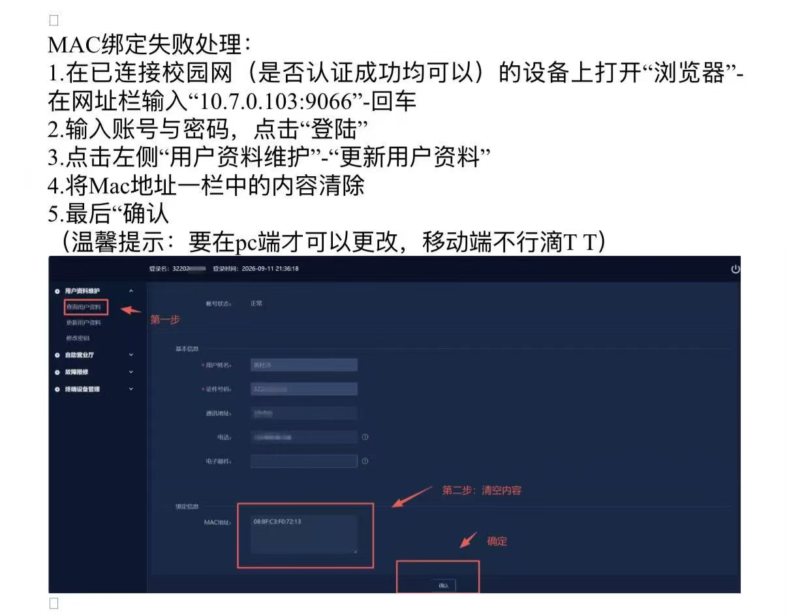

# Fedora Campus Net Fix

基于 Fedora 44 Workstation（Linux 发行版），通过配置 NetworkManager 校园网认证路由补丁，解决了 Linux 环境下北京理工大学珠海校区（BITZH）的校园网接入问题。


版本 **1.0.0**，整理日期 **2026-10-29（北京时间）**。

它帮助处理代理 TUN 接管认证地址、DHCP 换网段后认证路由仍使用旧网关、认证入口缺少当前 IP/MAC 参数等情况。它不是学校官方软件，也不能修复所有校园网故障。

## 快速开始

解压 ZIP，进入解压后的目录，用普通用户在本机终端运行：

```bash
python3 campus-net-fix.py --apply --open
```

也可以运行快捷入口：

```bash
bash run.sh
```

如果有多张已连接的有线网卡，请指定接口：

```bash
python3 campus-net-fix.py --apply --interface enp2s0 --open
```

脚本会输出完整认证链接，并通过 `xdg-open` 调用默认浏览器。请在校园网页面自行输入账号密码；脚本不收集或保存凭据。默认浏览器不一定是 Chrome，可以复制输出的完整链接到 Chrome 地址栏，保留 `http://` 和查询参数。

**只访问 `http://10.7.0.103:30004/` 不等于进入登录页。** 本次该根目录返回的是 `Server Working.`；实际入口是 `/byod/index.html`，附带当前 IP 和 MAC 参数，再由服务器跳转到登录页面。

## 环境要求

- Fedora，网络由 NetworkManager 管理。
- Python 3.8 或更新版本；只使用标准库，无 pip 依赖。
- 系统命令：`nmcli`、`ip`、`curl`；自动打开浏览器另需 `xdg-open`。
- 有线网卡已经插线，并获得 IPv4 地址和网关。
- 当前用户可修改相应 NetworkManager 连接；权限不足时在本机桌面终端按系统提示授权。

脚本会实时重新应用有线连接参数，可能触发 DHCP 续租；不操作手机 USB 共享配置。

## 常用命令

| 用途 | 命令 |
| --- | --- |
| 修复并打开登录页 | `python3 campus-net-fix.py --apply --open` |
| 只检查，不修改 | `python3 campus-net-fix.py --status` |
| 撤销脚本管理的路由修改 | `python3 campus-net-fix.py --undo` |
| 查看参数 | `python3 campus-net-fix.py --help` |
| 离线自检 | `python3 -m unittest discover -s tests -v` |

**重新插线、重新获取 IP，或网关变化后，请再次运行脚本。** 本版本不包含后台服务或开机任务，因此不会自动跟随 DHCP 更新路由。已保存的路由则会随连接保留。

## 修改和撤销的范围

脚本仅在选定的 NetworkManager 连接上添加认证服务器的 `/32` 主机路由。它可更新一条格式简单、网关已过期的同目标路由，并记录原路由。已有正确路由保持不变；复杂路由不自动改写。

撤销记录默认位于 `~/.local/state/campus-net-fix/routes.json`，如果设置了 `XDG_STATE_HOME` 则使用该目录。请始终用同一普通用户运行。`--undo` 删除脚本添加的路由，或还原脚本更新前的路由；它不会删除此前手动或聊天中添加、且没有被脚本接管的路由。

如果还原的是过期路由，原有问题可能再次出现，这是恢复原配置的结果。详情见 [使用与撤销说明](docs/USAGE.md)。

## 排查结论与验证范围

本次已确认：Realtek PCI 网卡被识别且物理链路接通；认证地址曾被导向 Meta 虚拟网卡；修正路由后，抓包可见与认证服务器正常双向 TCP 通信；校园网曾返回带当前 IP/MAC 的 BYOD 入口；之后 DHCP 换网段，需更新旧路由。

**未将“IP 冲突提示”的根因确认为已解决。** 也没有以 HTTP 200 作为已完成账号认证、Chrome 已正常显示、或已独立访问互联网的证明。

脚本和专用路由曾在本机运行，入口返回 HTTP 200。发布包另含离线测试，覆盖入口解析、重复运行、网关变化、撤销和既有路由保留；这些测试不修改真实网络。登录后需暂时停用 USB 共享及代理 TUN，再访问普通网页，确认校园网能独立上网。

## 文件

```text
fedora-campus-net-fix-v1.0.0/
├── README.md
├── campus-net-fix.py
├── run.sh
├── undo.sh
├── VERSION
├── CHANGELOG.md
├── LICENSE
├── .gitignore
├── docs/
│   ├── USAGE.md
│   ├── TROUBLESHOOTING.md
│   └── SESSION-SUMMARY.md
└── tests/
    └── test_patch.py
```

- [对话与排查归纳](docs/SESSION-SUMMARY.md)
- [故障排查](docs/TROUBLESHOOTING.md)
- [使用与撤销](docs/USAGE.md)


